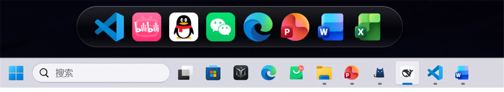
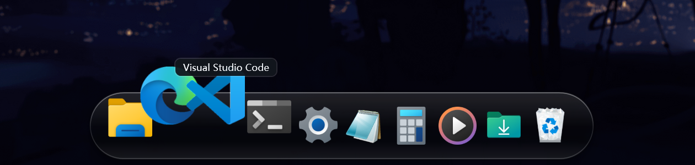
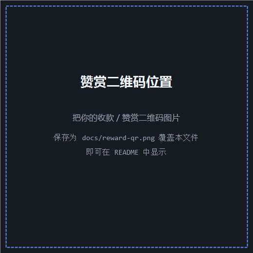

# ZyDock

一个用 **C# / WPF / .NET 8** 写的 Windows 11 桌面 Dock：悬浮在屏幕底部、近乎全透明的清玻璃、磁吸放大、真实系统图标、拖入即添加、拖动即排序。

无第三方依赖、不联网、不收集任何数据。


| Dock 近景 | 悬停放大 + 名称提示 |
| --- | --- |
|  |  |

---

## ✨ 功能

- **清玻璃底板**：不模糊、不取壁纸、无噪点，桌面直接透出；颜色可选，也可以完全清底
- **磁吸放大**：指针靠近时图标平滑放大，静止时零帧开销
- **真实系统图标**：直接读取应用原始图标（含 UWP 官方 logo）
- **拖入即添加**：从资源管理器把 exe / 快捷方式 / 文件夹拖到 Dock 上即可
- **拖动排序**：按住图标左右拖，松手保存
- **自动隐藏**：鼠标离开滑出屏幕，移到屏幕底边唤回
- **最大化 / 全屏 / 分屏铺满时自动隐藏**：前台窗口占满屏幕时 Dock 完全让位，还原后自动恢复
- **透明区穿透**：阴影和留白不挡桌面点击
- 托盘常驻、单实例、高 DPI、与系统任务栏共存

---

## 🚀 下载与运行

**下载地址：<https://github.com/ln-noi/ZyDock/releases/latest>**

| 下载哪个文件 | 大小 | 说明 |
| --- | --- | --- |
| **`ZyDock-1.0.0-single-file.exe`** | 63 MB | **单文件版（推荐）**：自带 .NET 运行时，放进任意目录双击即可 |
| `ZyDock-1.0.0-single-file.zip` | 58 MB | 单文件版的压缩包，内容与上一行完全相同（平台不允许传 exe 时用） |
| `ZyDock-1.0.0-folder.zip` | 61 MB | 目录版：解压出整个文件夹，启动更快、不依赖 `%TEMP%` |
| `SHA256SUMS.txt` | 1 KB | 上面三个文件的 SHA-256 |

> 单文件版和目录版是**同一个程序的两种打包**，不是两个版本。目录版必须**整个文件夹一起用**，单独拷走 exe 会打不开。

### 首次运行

1. 双击 `ZyDock-1.0.0-single-file.exe`
2. 出现「Windows 已保护你的电脑」→「更多信息」→「仍要运行」（未签名，属正常）
3. 2–5 秒后 Dock 出现在屏幕底部，首次启动会自动生成配置与图标

**系统要求**：Windows 10 / 11 x64，无需安装 .NET、无需联网。

---

## 🖱️ 怎么用

| 操作 | 行为 |
| --- | --- |
| 左键单击图标 | 启动应用 / 打开文件夹 |
| 悬停图标 | 放大 + 名称气泡 |
| 按住图标左右拖 | 调整顺序 |
| 从资源管理器拖文件到 Dock | 添加图标 |
| 右键图标 | 打开 / 在资源管理器中显示 / 从 Dock 移除 |
| 右键 Dock 空白处 | 打开设置 |
| 右键托盘图标 | 打开设置 / 退出 |

所有外观与行为选项都在**「打开设置」**里（外观 / 行为 / 图标管理 / 关于），改动即时生效。

---

## 🔒 校验与安全

```powershell
Get-FileHash .\ZyDock-1.0.0-single-file.exe -Algorithm SHA256
```

与下载页 `SHA256SUMS.txt` 里的值一致即可。

| 项目 | 结论 |
| --- | --- |
| 网络 | 零联网代码，无遥测、无自动更新 |
| 第三方依赖 | 0 个 NuGet 包，仅 .NET 官方库 |
| 权限 | 普通用户权限，不请求管理员、不装服务、不替换 Shell |
| 文件写入 | 仅 `%APPDATA%\ZyDock`（配置）与 `%LOCALAPPDATA%\ZyDock\logs`（日志，路径已脱敏） |

---

## ☕ 赞赏

如果它让你的桌面顺手了一点，可以请作者喝杯咖啡：

<!-- 把你的赞赏码 / 收款码保存为 docs/reward-qr.png 即可自动显示在这里 -->


> 二维码图片位置：`docs/reward-qr.png`（替换同名文件即可）。

---

## 📝 变更记录与许可

- 逐轮变更记录见 **[CHANGELOG.md](CHANGELOG.md)**
- 当前未附加开源许可证文件
